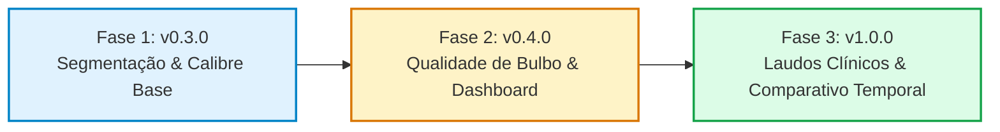

# Product Backlog: Sistema de Detecção e Tricometria Capilar

> **Objetivo Principal:** Desenvolver uma plataforma tricoscópica inteligente capaz de detectar fios e bulbos capilares em imagens de alta resolução/dermatoscópio, calcular o calibre/espessura individual dos fios em micrômetros ($\mu m$) e mensurar a qualidade e integridade dos bulbos capilares.

---

## 🎯 Visão do Produto & Objetivos Técnicos

1. **Detecção e Segmentação Fina:**
   - Identificar unidades foliculares (únicas, duplas, triplas), fios individuais e bulbos capilares.
   - Migrar de caixas delimitadoras (*Bounding Boxes*) para **Segmentação de Instância (YOLO-Seg / Mask2Former)** para capturar a geometria contínua do fio e o formato do bulbo.
2. **Tricometria (Cálculo de Espessura):**
   - Extrair a linha central (*medial axis* / esqueletização) da haste capilar segmentada.
   - Calcular perfis ortogonais de diâmetro ao longo do fio, obtendo espessura média, mínima e máxima por haste.
   - Conversão de pixels para $\mu m$ através de calibração por padrão de escala (micrômetro de mira ou referência conhecida da lente/dermatoscópio).
   - Classificação clínica: fios vellus ($< 30\,\mu m$), intermediários ($30 - 50\,\mu m$) e terminais ($> 50\,\mu m$).
3. **Avaliação da Qualidade do Bulbo:**
   - Morfometria: área, circularidade, integridade de bainha radicular externa/interna e densidade óptica.
   - Análise de viabilidade (relevante para tricologia e transplante capilar FUE/FUT).
   - Escore de qualidade composto (Score de 0 a 100 ou classificação Qualitativa: *Excelente, Bom, Fragilizado, Distrófico*).

---

## 📋 Épicos e Tarefas

### ÉPICO 1: Dataset, Anotação e Modelos de IA (Segmentação)
*Objetivo: Construir a base de dados anotada e treinar modelos de visão computacional de alta acurácia para fios e bulbos.*

- [ ] **E1.1 - Padronização da Taxonomia de Classes** `[Prioridade: Alta]`
  - Definir classes formais de anotação: `hair_shaft` (haste/fio), `hair_bulb` (bulbo), `follicular_unit` (unidade folicular).
- [ ] **E1.2 - Protocolo de Coleta e Calibração Óptica** `[Prioridade: Alta]`
  - Registrar resolução, ampliação (ex: 20x, 50x, 70x) e fator de conversão de escala ($\mu m/\text{pixel}$) por dispositivo.
- [ ] **E1.3 - Rotulagem Poligonal de Fios e Bulbos** `[Prioridade: Alta]`
  - Anotar máscaras poligonais de hastes capilares e regiões de bulbo em lote de imagens (CVAT / LabelMe).
- [ ] **E1.4 - Treinamento de Modelo YOLO-Seg (YOLOv8x-seg / YOLOv11-seg)** `[Prioridade: Alta]`
  - Treinar e validar modelo de segmentação de instâncias com mAP50 e mAP50-95 superiores a 85%.
- [ ] **E1.5 - Augmentation Específico para Tricoscopia** `[Prioridade: Média]`
  - Incluir variações de iluminação, reflexo de óleo/gel de contato e ruído de foco em `aug_ds.py`.

---

### ÉPICO 2: Algoritmo de Cálculo de Espessura do Fio (Calibre Capilar)
*Objetivo: Transformar máscaras de segmentação em métricas tricométricas confiáveis em micrômetros.*

- [ ] **E2.1 - Algoritmo de Esqueletização e Medline** `[Prioridade: Alta]`
  - Implementar afinamento morfológico (Zhang-Suen ou Lee) para traçar o eixo central da haste capilar.
- [ ] **E2.2 - Amostragem de Vetores Normais Perpendiculares** `[Prioridade: Alta]`
  - Em cada ponto do esqueleto, calcular o vetor normal à curva do fio e medir a largura perpendicular da máscara binária.
- [ ] **E2.3 - Módulo de Calibração Métrica ($\mu m$/pixel)** `[Prioridade: Alta]`
  - Permitir calibração manual (traçar linha de 1 mm na imagem) ou seleção de perfil pré-calibrado do dermatoscópio.
- [ ] **E2.4 - Classificação e Estatística de Hastes** `[Prioridade: Alta]`
  - Computar calibre médio, desvio padrão, mediana e classificar cada fio em:
    - *Vellus* / miniaturizado ($< 30\,\mu m$)
    - *Intermediário* ($30 - 50\,\mu m$)
    - *Terminal* ($> 50\,\mu m$)
  - Cálculo do índice de miniaturização capilar (% de fios $< 30\,\mu m$ por área).
- [ ] **E2.5 - Filtragem de Outliers e Fios Sobrepostos** `[Prioridade: Média]`
  - Descartar pontos de cruzamento entre dois fios para não superestimar a espessura.

---

### ÉPICO 3: Algoritmo de Avaliação da Qualidade do Bulbo
*Objetivo: Analisar morfológica e estruturalmente os bulbos detectados.*

- [ ] **E3.1 - Extração de Parâmetros Morfométricos do Bulbo** `[Prioridade: Alta]`
  - Cálculo de área, perímetro, eixo maior/menor, circularidade e elipsometria da região do bulbo.
- [ ] **E3.2 - Análise de Densidade Óptica e Textura** `[Prioridade: Média]`
  - Analisar gradiente de intensidade, contraste e integridade da matriz capilar e papila dérmica.
- [ ] **E3.3 - Classificação de Fases / Estado de Preservação** `[Prioridade: Média]`
  - Identificar características típicas de fase Anágena (bulbo pigmentado, elíptico e volumoso) vs Telógena (bulbo em clava, despigmentado e miniaturizado) ou bulbos fraturados.
- [ ] **E3.4 - Cálculo do Escore de Qualidade do Bulbo (Bulb Quality Index - BQI)** `[Prioridade: Alta]`
  - Função matemática ponderada (Área + Simetria + Densidade Óptica) gerando um score normalizado (0 a 100) e status (*Ótimo, Regular, Comprometido/Distrófico*).

---

### ÉPICO 4: Backend & Pipeline de Processamento (FastAPI)
*Objetivo: Integrar os algoritmos de visão e tricometria na API REST de alto desempenho.*

- [ ] **E4.1 - Novo Schema de Dados para Métricas Detalhadas** `[Prioridade: Alta]`
  - Atualizar banco SQLite para persistir:
    - `hair_measurements`: fio_id, espessura_media_um, espessura_min_um, espessura_max_um, categoria, coordenadas_haste.
    - `bulb_measurements`: bulbo_id, area_px, area_um2, circularidade, score_qualidade, status.
- [ ] **E4.2 - Pipeline de Inferência Híbrida (`/api/analyze-advanced`)** `[Prioridade: Alta]`
  - 1. Segmentação (YOLO) $\rightarrow$ 2. Esqueletização e Calibre $\rightarrow$ 3. Análise de Bulbos $\rightarrow$ 4. Montagem da imagem com overlay vetorial e payload JSON estruturado.
- [ ] **E4.3 - Suporte a Perfil de Calibração na Requisição** `[Prioridade: Alta]`
  - Receber parâmetro `microns_per_pixel` ou `preset_device` no endpoint de análise.
- [ ] **E4.4 - Processamento Assíncrono para Imagens Gigantes** `[Prioridade: Baixa]`
  - Fila de processamento em background (Celery/RQ ou FastAPI BackgroundTasks) para imagens de altíssima resolução.

---

### ÉPICO 5: Interface do Usuário (Frontend Especialista)
*Objetivo: Proporcionar ao tricologista/médico visualização clara, controle de camadas e compreensão diagnóstica.*

- [ ] **E5.1 - Visualizador Tricoscópico Interativo** `[Prioridade: Alta]`
  - Componente com zoom/pan e camadas toggláveis:
    - [x] Mostrar/ocultar fios detectados
    - [x] Mostrar/ocultar bulbos
    - [x] Exibir linha de calibre sobre a haste
    - [x] Exibir badges com valores de espessura ($\mu m$) e score do bulbo
- [ ] **E5.2 - Painel de Métricas Tricométricas na Sessão** `[Prioridade: Alta]`
  - Gráficos de distribuição:
    - Histograma de espessura dos fios ($\mu m$).
    - Percentual de miniaturização (% vellus vs terminais).
    - Média geral de espessura e contagem total por $cm^2$.
    - Distribuição de qualidade dos bulbos (Score médio e gráfico de pizza).
- [ ] **E5.3 - Ferramenta de Calibração Manual no Frontend** `[Prioridade: Média]`
  - Régua interativa na tela para o usuário traçar uma distância conhecida e definir o $\mu m/\text{px}$.
- [ ] **E5.4 - Comparativo Lado a Lado entre Sessões** `[Prioridade: Média]`
  - Comparar a evolução da espessura do fio e densidade entre a Sessão 1 (Baseline) e Sessões de retorno.

---

### ÉPICO 6: Relatórios, Laudos e Exportação
*Objetivo: Gerar documentos formais para entrega ao paciente ou prontuário médico.*

- [ ] **E6.1 - Laudo em PDF Tricoscópico** `[Prioridade: Média]`
  - Geração de laudo elegante contendo dados do paciente, data, mapa das áreas avaliadas, fotos anotadas, contagem, densidade, histograma de espessura e escore dos bulbos.
- [ ] **E6.2 - Exportação de Dados em CSV/Excel** `[Prioridade: Baixa]`
  - Permitir download da tabela com medição individual de cada fio e bulbo para fins de pesquisa clínica.

---

## 🗺️ Roadmap Sugerido

1. **Fase 1 (v0.3.0) - Tricometria & Segmentação:**
   - Transição para modelo YOLO-Seg.
   - Algoritmo de esqueletização e medição de calibre capilar em $\mu m$.
   - Armazenamento das espessuras individuais no banco.
2. **Fase 2 (v0.4.0) - Análise de Bulbos & Interface Rica:**
   - Módulo de extração morfológica e Bulb Quality Index (BQI).
   - Visualizador de camadas interativas no frontend.
   - Gráficos de histograma de calibre e distribuição de integridade dos bulbos.
3. **Fase 3 (v1.0.0) - Produto Completo para Clínica:**
   - Laudos em PDF automatizados.
   - Comparativo temporal de densidade e espessura entre sessões.
   - Calibração de dispositivos múltiplos.
